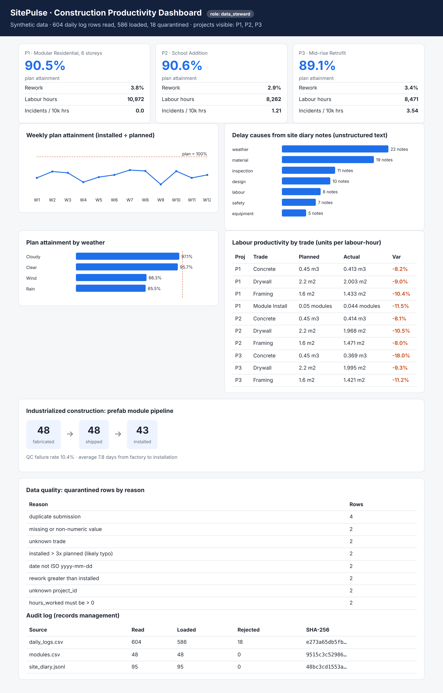
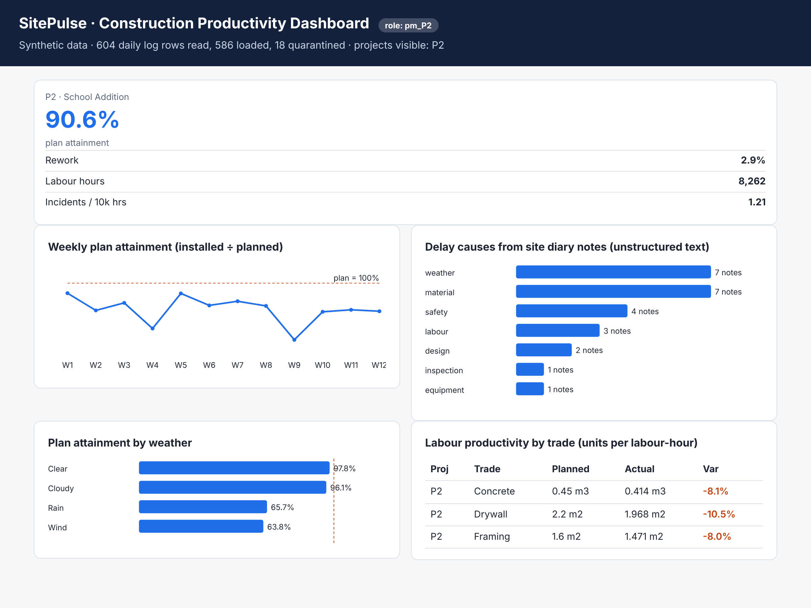

# SitePulse: Construction Productivity Data Pipeline & KPI Dashboard

SitePulse takes the messy data a construction site produces every day and turns it into trusted productivity metrics:

- structured daily production logs (CSV)
- prefab module tracking for industrialized (modular) construction (CSV)
- free-text site diary notes, which are unstructured (JSONL)

It **ingests** all three sources, **validates** every row, **quarantines** bad records with a stated reason, **loads** clean data into SQLite, computes **KPIs with SQL**, and publishes an HTML **dashboard filtered by role**. Each run is recorded in an **audit log** with a SHA-256 checksum of every input file.

> All data is **synthetic**, created by `sitepulse/generate_sample.py` with a fixed seed. No real company or project data is used.



## What it demonstrates

| Area | How SitePulse does it |
|---|---|
| Data ingestion & integration | Three sources in two formats (CSV, JSONL) loaded into one relational model |
| Data quality | 8 validation rules (date format, unknown project or trade, negative hours, hours over 14 per worker, impossible output, rework greater than installed, missing values, duplicates). Bad rows are quarantined with a reason, never silently dropped |
| Unstructured data | Site diary notes classified into delay causes (weather, material, inspection, design, labour, safety, equipment), with lost hours extracted from the text |
| KPIs | Plan attainment, labour productivity per trade (planned vs actual units per labour-hour), rework rate, incidents per 10,000 hours, weather impact, weekly trend |
| Industrialized construction | Module pipeline (fabricated → shipped → installed), QC failure rate, average days from factory to installation |
| Controlled access | Role-based, least-privilege views: a project manager sees only their own project. Unknown roles are denied by default. Only the data steward sees quarantined records |
| Records management | `run_log` audit table: timestamp, source file, SHA-256, rows read, loaded and rejected |

## Results on the sample data

```
SitePulse  role=data_steward  projects=P1,P2,P3
  daily_logs.csv   read 604  loaded 586  quarantined 18
  modules.csv      loaded 48
  site_diary.jsonl classified 95 free-text notes
  P1: plan attainment 90.5%  rework 3.8%  incidents/10k hrs 0.0
  P2: plan attainment 90.6%  rework 2.9%  incidents/10k hrs 1.21
  P3: plan attainment 89.1%  rework 3.4%  incidents/10k hrs 3.54
```

- All 18 problem rows were caught: 14 injected errors and 4 duplicate submissions. Every row is accounted for (read = loaded + quarantined).
- Rain and wind days reached only about 66% of plan, compared with about 96% on clear or cloudy days.
- Weather (22 notes) and material supply (19 notes) were the top delay causes found in the free-text diary.
- Prefab modules: 48 fabricated, 43 installed, a 10.4% QC failure rate, and an average of 7.8 days from factory to installation.

## Run it

Python 3.10+ only. It uses the standard library, with no dependencies.

```bash
python -m sitepulse --generate --role data_steward   # full view, including data quality and audit log
python -m sitepulse --role pm_P2                     # project manager: sees P2 only
python -m sitepulse --role contractor_x              # ACCESS DENIED (deny by default)
python -m unittest discover -v                       # 8 tests
```

Outputs go to `sample_data/`: `dashboard_<role>.html`, `kpis_<role>.json` and `data_quality.json`.



## Project layout

```
sitepulse/
  generate_sample.py  synthetic data with realistic data-quality problems
  pipeline.py         ingest, validate, quarantine, load to SQLite, audit log, text classification
  kpis.py             KPI queries (SQL) filtered by the role's projects
  access.py           role-based, least-privilege access (deny by default)
  report.py           self-contained HTML dashboard (inline SVG charts)
  __main__.py         command-line interface
tests/                8 unit and end-to-end tests
sample_data/          generated inputs and outputs
docs/                 screenshots and CLI output
```

## Author

Nousheen Fathima. Copyright, all rights reserved (see LICENSE).
